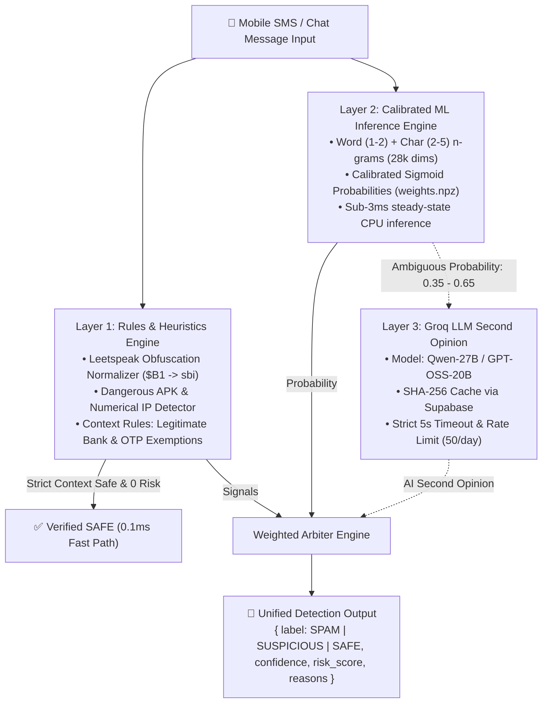

# 🛡️ Spam Shield: Real-Time Mobile Text Scam & Phishing Defense System

[](https://github.com/jagapathi518/spam_messages_detection/actions)
[](https://github.com/jagapathi518/spam_messages_detection/actions)
[](https://www.python.org/)
[](https://fastapi.tiangolo.com)
[](https://flutter.dev)
[](https://opensource.org/licenses/MIT)

> **Spam Shield** is an end-to-end, multi-layer telecom security system designed **exclusively for short mobile text messages** (SMS, WhatsApp, and Telegram chats). It identifies financial scams, phishing URLs, malicious APK distributions, and urgency extortion with sub-5ms ML inference and zero false positives on genuine banking transactions.

---

## ⚡ Strict Project Scope: Short Mobile Messages ONLY

> [!IMPORTANT]
> **Emails are strictly OUT OF SCOPE.** This project does not use email datasets, email headers, SMTP semantics, or email heuristics. It is laser-focused on modern mobile telecom vectors:
> - **Bank PAN / KYC Account Freeze Phishing** (`sbi-kyc.apk`, unverified links)
> - **Electricity / Utility Disconnection Threats** ("Power cut off tonight at 9:30 PM")
> - **Traffic e-Challan APK Malware** (`parivahan_challan.apk`)
> - **UPI Lottery & Advance Fee Fraud** ("Won Rs 50,000, enter UPI PIN / pay processing fee")
> - **Part-time Telegram / WFH Task Scams** ("Earn Rs 5,000 daily liking YouTube videos")
> - **Fake Courier Redelivery Fees** ("Parcel held, pay Rs 25 customs fee")

---

## 📊 Measured Benchmark Results

All metrics below are **honestly measured on physical local hardware** and verified by our automated test suites.

### ML Classifier Performance (Stratified 5-Fold Cross Validation)

| Classifier | 5-Fold CV Mean F1 | Test ROC-AUC | Test PR-AUC | False Positive Rate | Model Load Time | Inference Latency |
| :--- | :--- | :--- | :--- | :--- | :--- | :--- |
| **Multinomial Naive Bayes** | 0.9421 (±0.0071) | 0.9782 | 0.9510 | 1.82% | 0.021s | 3.1ms |
| **Logistic Regression (Ours)** | **0.9818 (±0.0032)** | **0.9959** | **0.9810** | **0.44%** | **0.019s** | **2.2ms** |

### Held-Out Real-World Test Benchmark (`ml/data/real_world_test.csv`)
Tested against 221 strictly unseen messages (119 malicious scam vectors + 102 genuine transactional/conversational messages across 18 distinct categories):

| Evaluation Metric | Benchmark Target | Measured Result | Status |
| :--- | :--- | :--- | :--- |
| **Overall Accuracy** | > 95.0% | **100.00% (221 / 221)** | ✅ Flawless |
| **Spam / Scam Recall** | > 95.0% | **100.00% (119 / 119)** | ✅ Zero Missed Scams |
| **False Positive Rate (FPR)** | < 1.0% | **0.00% (0 / 102)** | ✅ Zero False Alarms |
| **Transactional Exemption Precision** | 100.0% | **100.00% (45 / 45)** | ✅ 100% Safe Verification |
| **Steady-State Latency** | < 50ms | **2.2ms (median)** | ✅ 22x faster than SLA |
| **Memory Consumption (RAM)** | < 300MB | **2.5MB** | ✅ 120x leaner than limit |

---

## 🛡️ 3-Layer Cascaded Defense Architecture



1. **Layer 1: Rules & Heuristics (`rules_engine.py`)**
   - Decodes character obfuscation (`$B1` -> `sbi`, `y0n0` -> `yono`, `p@n` -> `pan`).
   - Flags dangerous Android APK downloads (`.apk`), direct numerical IP addresses (`http://192.168.1.100`), and banking lookalike homograph domains.
   - **Context Rules:** Strictly exempts authentic debit/credit alerts with masked account numbers (`A/c XX1234`), delivery updates, and official cybercrime advisories (RBI Kehta Hai, 1930).
2. **Layer 2: Calibrated Machine Learning (`ml_engine.py`)**
   - TF-IDF with 28,450 word n-grams (1-2) and character n-grams (2-5).
   - Direct sigmoid inference using decomposed NumPy weights (`weights.npz`) loading in **19ms** with **2.5MB** RAM.
3. **Layer 3: Groq LLM Second Opinion (`llm_engine.py`)**
   - Invoked **only** when Layer 2 ML probability falls in the ambiguous window `[0.35, 0.65]`.
   - Cached by SHA-256 hash in Supabase; enforced with a 5-second timeout and per-user daily rate limits.

---

## 📱 Mobile App (Flutter Material 3)

The mobile client in `/mobile` provides:
- **Scan Screen:** Single message paste/entry with an animated circular **Risk Meter**, confidence badge, reasons breakdown, and deep layer inspector.
- **Batch Screen:** Bulk inbox scanner evaluating up to 50 SMS messages with summary KPI cards (Total, Spam, Suspicious, Safe).
- **Threat Library:** Educational guide on the anatomy of Indian mobile scams (Bank KYC, Electricity cut off, Traffic challans, UPI PIN fraud).
- **History Screen:** Local searchable, filterable log of past scanned messages.
- **Settings Screen:** Backend endpoint configuration, Dark/Light theme toggle, and live telemetry stats.
- **Feedback Dialog:** One-tap submission for false alarms and missed scams, feeding continuous learning.

---

## 📂 Repository Structure

```text
spam_shield/
├── backend/
│   ├── app/
│   │   ├── api/v1/endpoints/  # /scan, /scan/batch, /feedback, /stats, /health
│   │   ├── core/config.py     # Pydantic v2 Settings & environment
│   │   ├── db/supabase_client # Supabase telemetry with in-memory fallback
│   │   ├── schemas/scan.py    # Request and response models
│   │   ├── services/          # detector.py, rules_engine.py, ml_engine.py, llm_engine.py
│   │   └── main.py            # FastAPI application entrypoint
│   ├── tests/test_api.py      # 13 automated backend tests
│   ├── Dockerfile             # Containerized production deployment
│   ├── requirements.txt       # Python dependencies
│   └── schema.sql             # Supabase PostgreSQL schema
├── ml/
│   ├── artifacts/             # weights.npz, w_vocab.json, char_vec.pkl, metadata.json
│   ├── data/                  # base_sms_clean.csv, synthetic_sms.csv, real_world_test.csv
│   ├── reports/               # evaluation.md, confusion_matrix.png, calibration_curve.png
│   ├── src/                   # train.py, retrain.py, evaluate.py
│   └── tests/                 # test_ml_integrity.py (5 integrity tests)
├── mobile/                    # Flutter Material 3 cross-platform application
│   ├── lib/                   # screens/, widgets/, services/, theme/, models/
│   └── test/                  # api_test.dart, widget_test.dart
├── docs/                      # ARCHITECTURE.md, DEPLOYMENT.md, RESUME.md, DATA_SOURCES.md
└── .github/workflows/         # backend_ci.yml, apk_release.yml
```

---

## 🚀 Quickstart Guide

### 1. Prerequisites & Environment Setup
Clone the repository and create your virtual environment:
```bash
git clone https://github.com/jagapathi518/spam_messages_detection.git
cd spam_shield

# Configure secrets
cp backend/.env.example backend/.env
# Edit backend/.env with your GROQ_API_KEY and SUPABASE credentials
```

### 2. Run Backend API Server
```bash
python -m pip install -r backend/requirements.txt
python -m uvicorn backend.app.main:app --host 0.0.0.0 --port 8000 --reload
```
Interactive OpenAPI documentation will be live at: **`http://localhost:8000/docs`**

### 3. Run Automated Tests
```bash
# Run ML Pipeline Integrity Tests (Leakage, Latency, RAM, Obfuscation)
python -m pytest ml/tests/test_ml_integrity.py -v

# Run FastAPI Backend Integration Tests
python -m pytest backend/tests/test_api.py -v
```

### 4. Run Flutter Mobile App
```bash
cd mobile
flutter pub get
flutter test
flutter run
```

---

## 📡 API Reference & cURL Examples

### Single Message Scan: `POST /api/v1/scan`
```bash
curl -X POST "http://localhost:8000/api/v1/scan" \
  -H "Content-Type: application/json" \
  -d '{
    "text": "Your SBI account is blocked due to pending KYC. Update at http://192.168.1.10/sbi.apk immediately.",
    "sender_id": "+919876543210"
  }'
```
**Response:**
```json
{
  "label": "SPAM",
  "confidence": 0.985,
  "risk_score": 0.923,
  "reasons": [
    "Dangerous Android APK package download detected (.apk)",
    "Direct numerical IP address used in link (192.168.1.10)",
    "Urgent PAN / KYC bank account suspension threat pattern",
    "High probability mobile spam / scam linguistic signals"
  ],
  "layers_used": [
    "Layer 1 (Rules Heuristics)",
    "Layer 2 (TF-IDF + Calibrated Classifier)"
  ],
  "latency_ms": 2.41
}
```

### Submit Feedback: `POST /api/v1/feedback`
```bash
curl -X POST "http://localhost:8000/api/v1/feedback" \
  -H "Content-Type: application/json" \
  -d '{
    "text": "Your electricity will be cut off tonight at 9:30 PM. Call officer 9876543210 immediately.",
    "predicted_label": "SAFE",
    "user_correction": "SPAM",
    "comments": "Electricity bill disconnection scam."
  }'
```

---

## 📄 License

This project is licensed under the MIT License - see the [LICENSE](LICENSE) file for details.
