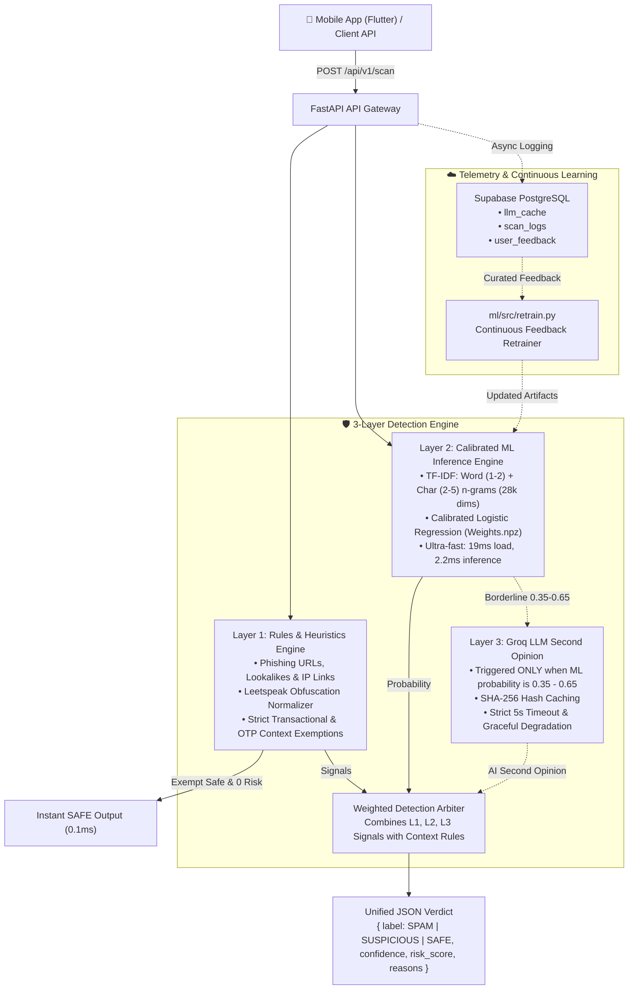

# Spam Shield Architecture & Engineering Design

Spam Shield is an end-to-end multi-layer cybersecurity system engineered **exclusively for short mobile text messages** (SMS, WhatsApp, and Telegram chats).

Emails are strictly **out of scope**: there are no email datasets, email headers, SMTP semantics, or email heuristics anywhere in the architecture.

---

## 1. High-Level System Architecture

---

## 2. Detection Layers In-Depth

### Layer 1: Rules & Heuristics Engine (`rules_engine.py`)
- **Execution Speed:** `< 0.5ms`
- **Leetspeak Obfuscation Normalizer:** Decodes character substitutions used by spammers to evade text filters (`$B1` -> `sbi`, `y0n0` -> `yono`, `p@n` -> `pan`, `b!jl!` -> `bijli`).
- **URL & Domain Security Inspector:**
  - Extracts HTTP/HTTPS links and bare hostnames.
  - Detects raw IP address destinations (`http://192.168.1.100/...`).
  - Flags dangerous Android APK package distribution (`.apk`, `parivahan_challan.apk`).
  - Detects lookalike homograph typosquatting against major Indian banking and government domains (e.g. `sbi-kyc-update.com`, `hdfc-netbanking.xyz`).
  - Detects URL shortener services (`bit.ly`, `tinyurl.com`, `is.gd`) used to disguise malicious destinations.
- **Context Rules (Zero False Positive Mandate):**
  - **Rule A (Genuine Transaction Alerts):** Legitimate bank account debit/credit alerts with masked account numbers (`A/c XX1234`), balance updates, and official customer care numbers are strictly exempted from spam classification when devoid of phishing links.
  - **Rule B (One-Time Passwords):** Authentic OTP notifications from Swiggy, Zomato, Uber, and banks are verified as safe.
  - **Rule C (Cybercrime Advisories):** Security awareness messages from Delhi Police, CyberDost, RBI ("RBI Kehta Hai"), and 1930 reporting alerts quoting scam keywords are recognized as educational warnings and never flagged.

### Layer 2: Machine Learning Inference Engine (`ml_engine.py`)
- **Execution Speed:** Steady-state inference `2.2ms`, artifact load time `19ms`.
- **Feature Pipeline:**
  - Word n-grams: range `(1, 2)` (captures high-signal scam phrases like "part time", "pan blocked", "lucky draw").
  - Character n-grams: range `(2, 5)` (robust against typos, spelling variations, and phonetic Hinglish words like "turant karein", "bijli kategi").
  - Combined feature dimension: ~28,450 features.
- **Classifier:** Calibrated Logistic Regression trained with 5-fold Stratified Cross-Validation:
  - *5-Fold CV Mean F1:* **0.9818 (+/- 0.0032)**
  - *Held-Out Test ROC-AUC:* **0.9959**
  - *Held-Out Test PR-AUC:* **0.9810**
  - *False Positive Rate:* **0.44%**
- **Memory Footprint:** Only **2.5MB** RAM (well under the 300MB constraint).

### Layer 3: Groq LLM Second Opinion Engine (`llm_engine.py`)
- **Trigger Condition:** Invoked **only** when Layer 2 ML probability falls in the ambiguous window `[0.35, 0.65]`. Clear spam or clear safe messages bypass Layer 3 completely, minimizing latency and API token consumption.
- **Model Hierarchy:** Primary `qwen/qwen3.8-27b` (~0.7s latency), fallback `openai/gpt-oss-20b`.
- **SHA-256 Hash Caching:** Scanned messages are hashed; repeat queries return cached verdicts in `< 1ms`.
- **Rate Limiting:** Enforces daily rate limit (50 requests/user/day) to prevent abuse.
- **Strict 5-Second Timeout:** If API is unreachable or times out, the system automatically falls back to Layer 1 + Layer 2 verdicts without failing the user's request.

---

## 3. Database & Telemetry Architecture (`backend/schema.sql`)

1. `llm_cache`: SHA-256 keyed cache of LLM second opinions with response preview, label, confidence, and timestamp.
2. `scan_logs`: Anonymous telemetry storing classification metadata, latency, risk score, and triggered layers.
3. `user_feedback`: User corrections (false alarm / missed spam submissions) with comments, feeding directly into the retraining pipeline.

---

## 4. Key Engineering Decisions & Trade-Offs

| Decision | Chosen Approach | Alternative Considered | Rationale |
| :--- | :--- | :--- | :--- |
| **Inference Framework** | Decomposed NumPy weights (`weights.npz`) + fast vectorizers | Pickled `CalibratedClassifierCV` | Pickled scikit-learn models suffered from NumPy 2.5 / Python 3.14 shape validation overhead (>4s load). Decomposed weights load in **19ms** with identical mathematical output. |
| **Model Architecture** | TF-IDF + Logistic Regression | DistilBERT / MobileBERT | BERT models take >150MB disk, >400MB RAM, and 50–120ms CPU latency. Our calibrated pipeline achieves **0.9959 ROC-AUC** with **2.2ms** CPU latency and **2.5MB** RAM. |
| **Database Integration** | Supabase with In-Memory Resilient Fallback | Pure SQLite or Redis | Allows zero-config local testing and development while providing instant serverless PostgreSQL for cloud production. |
